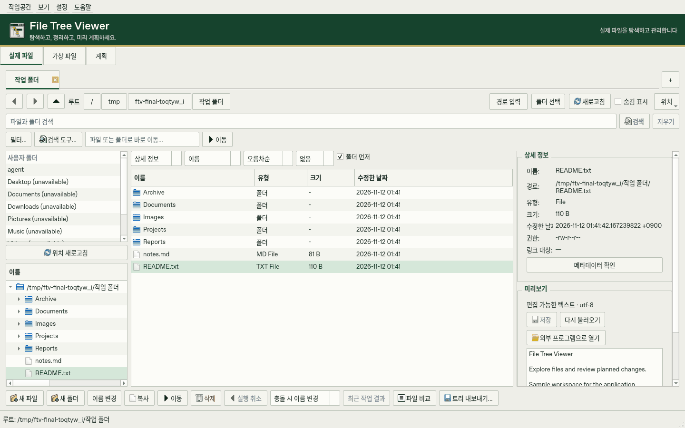
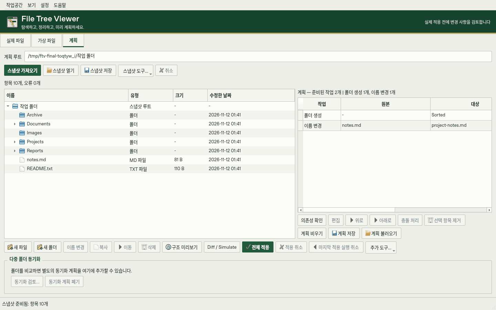

# File Tree Viewer

한국어 | [English](README.md)

File Tree Viewer는 실제 파일 탐색기, 가상 폴더 트리 편집기와 Snapshot 기반 변경
계획을 결합한 Python·PySide6 Windows 프로그램입니다. 파일을 직접 관리하거나
독립적으로 디렉터리 구조를 설계하고, 여러 변경을 준비해 디스크에 적용하기 전에
예상 결과를 살펴볼 수 있습니다.

## 주요 기능

### Real File System

탭·Breadcrumb·즐겨찾기와 편집 가능한 주소창으로 폴더를 탐색합니다.
파일 이름이나 내용을 검색하고 텍스트·이미지·바이너리를 미리 보거나 텍스트 편집과
메타데이터 확인을 할 수 있습니다. 복사·이동·이름 변경 등의 명령은 선택한 실제 파일에
적용되며, 지원하는 작업은 현재 세션에서 Undo할 수 있습니다.

### Virtual File System

실제 파일을 바꾸지 않고 메모리에서 폴더 트리와 텍스트 파일을 만들고 편집합니다.
구조를 JSON으로 저장해 다시 열고, 실제 폴더로 내보내거나 내용을 Plan에 준비할 수 있습니다.
디스크에 파일을 만들기 전에 프로젝트의 디렉터리 구성을 설계하는 데 적합합니다.

### Plan

폴더의 Snapshot을 만들고 파일·폴더 생성, 복사, 이동, 이름 변경과 삭제를 계획한 뒤
예상 구조와 충돌을 확인하고 적용합니다. Batch Rename과 정리 규칙으로 여러 변경을
준비할 수 있으며, 적용 기록을 바탕으로 Rollback·Undo·중단된 작업 복구를 지원합니다.

### 폴더 비교와 분석

두 폴더를 비교하고 충돌 검토를 거쳐 단방향·양방향 동기화를 준비합니다.
폴더별 용량, Treemap과 큰 파일 목록으로 디스크 사용량을 살펴보거나 중복 파일을
검토하고 선택한 정리 작업을 Plan에 준비할 수 있습니다.

### 내보내기와 작업 환경

폴더 트리를 미리 보거나 복사하고 TXT·Markdown·JSON으로 내보냅니다.
작업·복구 기록을 조회하고 JSON·CSV·HTML 보고서를 저장할 수 있습니다.
한국어·영어 UI, 라이트·다크·시스템 테마, 패널 배치 저장과 빠른 명령도 제공합니다.

## 화면

### Real File System

폴더 탐색, 파일 선택과 미리보기를 한 작업공간에서 사용합니다.



### Plan

Snapshot 트리와 준비한 작업 목록을 함께 보면서 변경을 검토합니다.



## 사용 방법

### 파일 탐색 또는 폴더 구조 설계

**Real**에서 폴더를 열어 탐색·검색·미리보기를 사용합니다. **Virtual**에서는 독립적인
트리를 만들고 JSON으로 저장한 뒤 준비가 되면 내보냅니다.
**Ctrl+1 / Ctrl+2 / Ctrl+3**으로 Real·Virtual·Plan을 전환할 수 있습니다.

### 여러 파일의 변경 계획 만들기

1. **Plan**에서 **Import Snapshot**을 선택하고 정리할 폴더를 지정합니다.
   Snapshot은 계획에 사용할 구조와 메타데이터를 기록합니다.
2. 작업 목록에 파일·폴더 생성, 이름 변경, 복사, 이동 또는 삭제를 추가합니다.
   이 단계에서는 변경을 준비할 뿐 원래 파일은 바뀌지 않습니다.
3. **Preview Structure**에서 원래 트리와 적용 후 예상 구조를 비교합니다.
4. **Diff / Simulate**로 충돌·의존성과 작업 세부 내용을 검토합니다.
5. **Apply All**을 선택하고 확인 내용을 검토한 뒤 계획한 변경을 적용합니다.
6. 완료한 Plan은 가능한 경우 **Undo Last Apply**로 되돌립니다.
   중단된 작업은 **Recover Interrupted Plan**에서 검토하고 복구합니다.

Snapshot은 파일 내용의 백업이 아닌 메타데이터를 기록합니다.
저장한 Virtual 트리·Snapshot·Plan은 나중에 다시 열 수 있습니다.
작업공간과 복구 동작의 자세한 설명은 사용법 문서에서 확인할 수 있습니다.

## 실행 방법

### 소스에서 실행

Python 3.12 이상을 사용합니다. 저장소 폴더에서 실행하세요.

```sh
python -m pip install -r requirements.txt
python main.py
```

### Windows 실행 파일 만들기

Windows에서 64비트 Python 3.12 이상을 `python` 명령으로 사용할 수 있어야 합니다.

```powershell
.\build_windows.bat
```

BAT는 현재 Python 환경에 빌드 의존성을 설치하고
`dist/FileTreeViewer/FileTreeViewer.exe`를 만듭니다. 생성된 폴더에서 EXE를 실행하고
`_internal/`을 비롯한 프로그램 파일을 함께 유지하세요. 빌드한 프로그램에는 Python과
Qt가 포함되며, 이 저장소의 소스코드에서 직접 생성하는 방식입니다.

설정과 작업 기록은 EXE 옆의 `data/`에 저장됩니다. 빌드한 프로그램을 업데이트하거나
옮길 때 이 폴더를 보존하세요. 저장한 Snapshot과 Plan은 직접 선택한 경로에 유지됩니다.
데이터 위치와 이전 방법은 포터블 실행 안내에 정리되어 있습니다.

## 문서

- [데스크톱 사용법](docs/ko/usage.md) — 작업공간 조작, 검색, 비교·동기화, 분석과 Plan 사용 흐름.
- [포터블 실행과 데이터](docs/ko/portable.md) — Windows 프로그램 폴더의 생성·실행, 설정·업데이트·데이터 이전.
