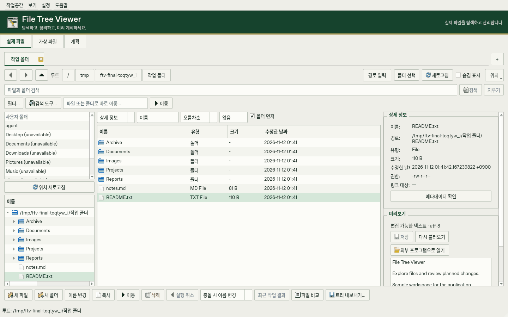
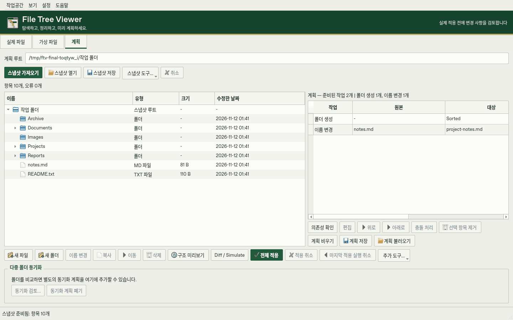

# File Tree Viewer

[English](README_EN.md) · [상세 사용법](docs/USAGE.md) · [포터블 실행 안내](docs/PORTABLE.md) · [개발·빌드](docs/DEVELOPMENT.md)

실제 파일 탐색, 가상 폴더 구성, 변경 계획 검토를 한곳에서 하는 Windows 데스크톱 프로그램입니다. 파일을 바로 관리하거나, Snapshot을 바탕으로 변경을 먼저 검토하고 적용할 수 있습니다.

## 주요 기능

| 작업공간 | 할 수 있는 일 |
| --- | --- |
| **Real · 실제 파일** | 폴더 탐색·탭·즐겨찾기, 이름·내용 검색, 파일 작업과 Undo, 텍스트·이미지·바이너리 미리보기 |
| **Virtual · 가상 파일** | 실제 파일을 바꾸지 않고 트리·텍스트 편집, JSON 저장·불러오기, 실제 폴더로 내보내기 |
| **Plan · 계획** | Snapshot 생성·저장·비교, 변경 미리보기·충돌 검토, 적용·Rollback·Undo·중단 복구 |

폴더 비교·단방향/양방향 동기화, 디스크 사용량·중복 분석, 작업·복구 기록도 제공합니다. 폴더 트리는 TXT·Markdown·JSON으로 내보내거나 클립보드에 복사할 수 있습니다. 한국어·영어와 Light·Dark·System 테마를 지원합니다.

## 화면

샘플 폴더를 연 실제 프로그램 화면입니다.

## 다운로드와 실행

**1.0.0 배포 준비 중이며 정식 릴리스는 아직 게시하지 않았습니다.** 검증이 완료된 개발 빌드는 [GitHub Actions의 Build Windows](https://github.com/Koreapanda4444/File-tree-viewer/actions/workflows/build-windows.yml)에서 성공한 실행의 **FileTreeViewer-windows-x64** 아티팩트로 받을 수 있습니다. 다운로드에는 GitHub 로그인이 필요하며, 아티팩트는 14일간 보관됩니다.

1. 아티팩트를 내려받아 내부의 `FileTreeViewer-1.0.0-windows-x64.zip`과 `SHA256SUMS`를 꺼냅니다.
2. 프로그램 ZIP **전체를 압축 해제**합니다.
3. `FileTreeViewer/FileTreeViewer.exe`를 실행합니다. Python 설치는 필요하지 않습니다.

`_internal/`은 실행에 필요한 라이브러리입니다. EXE만 따로 옮기지 말고 프로그램 폴더 전체를 보관하세요. 설치 프로그램·서비스·자동 시작 등록은 사용하지 않습니다.

## 처음 사용하기

- **Real**에서 폴더를 선택하고 파일을 탐색합니다. 외부 변경은 감시 중인 폴더에 자동 반영됩니다. 큰 폴더는 백그라운드에서 전체 정렬 후 페이지별로 표시합니다.
- **Virtual**에서 가상 트리를 구성합니다. 저장·내보내기 전에는 실제 파일을 만들지 않습니다.
- **Plan**에서 Snapshot을 가져와 변경을 준비합니다. **Diff / Simulate**와 변경 전후 구조를 검토한 뒤 **Apply All**로 적용합니다. 중요한 파일은 별도 백업하세요.
- **설정 → 환경설정**에서 언어와 테마를 선택합니다. 언어 변경은 재시작 후 적용됩니다.

## 단축키

| 키 | 기능 |
| --- | --- |
| `Ctrl+1` / `Ctrl+2` / `Ctrl+3` | Real / Virtual / Plan 전환 |
| `Alt+D` / `Ctrl+L` | 주소 입력 |
| `Alt+Left` / `Alt+Right` / `Alt+Up` | 뒤로 / 앞으로 / 상위 폴더 |
| `Ctrl+F` / `F5` | 검색 / 새로고침 |
| `Ctrl+C` / `Ctrl+X` / `Ctrl+V` | 파일 복사 / 잘라내기 / 붙여넣기 |
| `F2` / `Delete` | 이름 변경 / 휴지통 삭제 |
| `Ctrl+P` | 빠른 명령 검색 |

편집기에서는 텍스트 편집 단축키가 유지됩니다. 휴지통 삭제는 Real Undo 대상이 아닙니다.

## 데이터와 업데이트

| 데이터 | 저장 위치 |
| --- | --- |
| 설정·창 배치·즐겨찾기·최근 위치 | 프로그램 폴더의 `data/settings/preferences.ini` |
| 작업 기록 색인 | 프로그램 폴더의 `data/history/operation-history.sqlite3` |
| 저장한 Virtual·Snapshot·Plan·보고서 | 저장할 때 직접 선택한 위치 |
| Plan·동기화의 Journal·백업·잠금 | 각 대상 루트의 `.file-tree-viewer/transactions` 등 기존 복구 위치 |

`data/`는 필요할 때 생성합니다. 쓰기 권한이 없는 위치에서는 폴더 이동을 안내합니다. 캐시·로그용 빈 폴더는 만들지 않습니다.

업데이트할 때는 프로그램을 종료하고 기존 **`data/`를 보존**하세요. 다른 PC로 이동할 때는 폴더 전체를 복사합니다. 예전 PC의 경로·드라이브가 새 PC에도 존재하는지는 따로 확인해야 합니다. Snapshot은 파일 내용의 백업이 아니며, 복구 자료는 대상 드라이브에 남습니다. 복구 자료를 임의로 지우지 마세요.

이전 버전 설정·기록이 발견되면 첫 실행 또는 **설정 → 이전 데이터 가져오기**에서 복사할 수 있습니다. 원본과 기존 포터블 값은 보존하며, 기존 기록 DB를 덮어쓰거나 병합하지 않습니다. [자세한 실행·이전 안내](docs/PORTABLE.md)

## 사용 범위와 검증

파일 변경 전 원본 상태와 충돌을 검사하고, Plan·동기화는 트랜잭션 기록과 복구용 백업을 보관합니다. 외부 변경으로 안전한 복원이 불가능하면 기존 파일을 보존하고 복구를 차단합니다.

Windows CI는 파일 작업·Undo·Snapshot·Plan Rollback·동기화 충돌·검색·폴더 감시·트리 내보내기·데이터 이전을 검사합니다. 배포 빌드는 EXE 실행, 두 언어, 한글·공백 경로, 폴더 이동 후 설정·기록 유지, 압축 해제 실행과 SHA-256을 검증합니다. [검증 명령과 제약](docs/DEVELOPMENT.md)

원격 파일 시스템, 실제 전원 차단·장치 분리, Windows 탐색기와의 수동 드래그는 환경별 확인이 필요합니다. 단일 루트 Plan의 이동은 같은 파일 시스템 안에서만 지원합니다. 자세한 제한과 안전한 작업 순서는 [상세 사용법](docs/USAGE.md)을 참고하세요.
