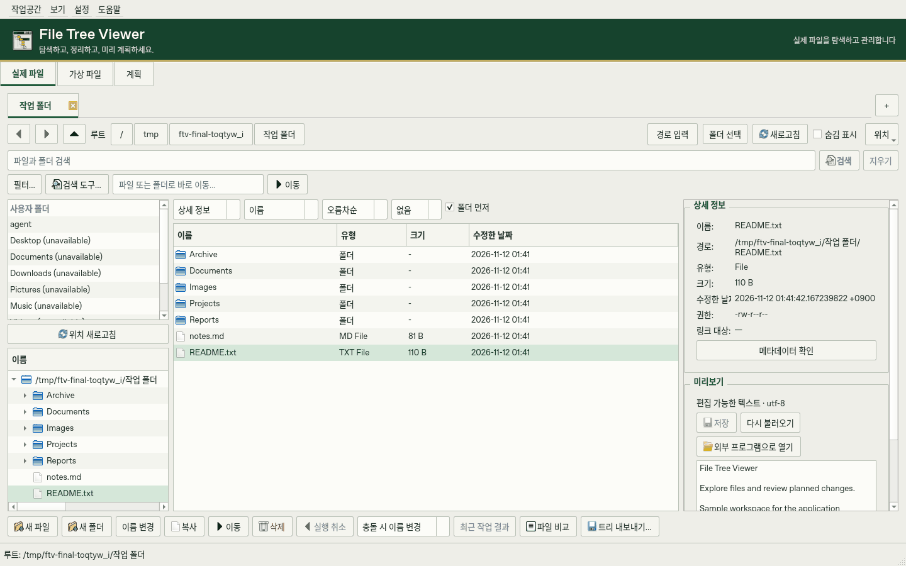
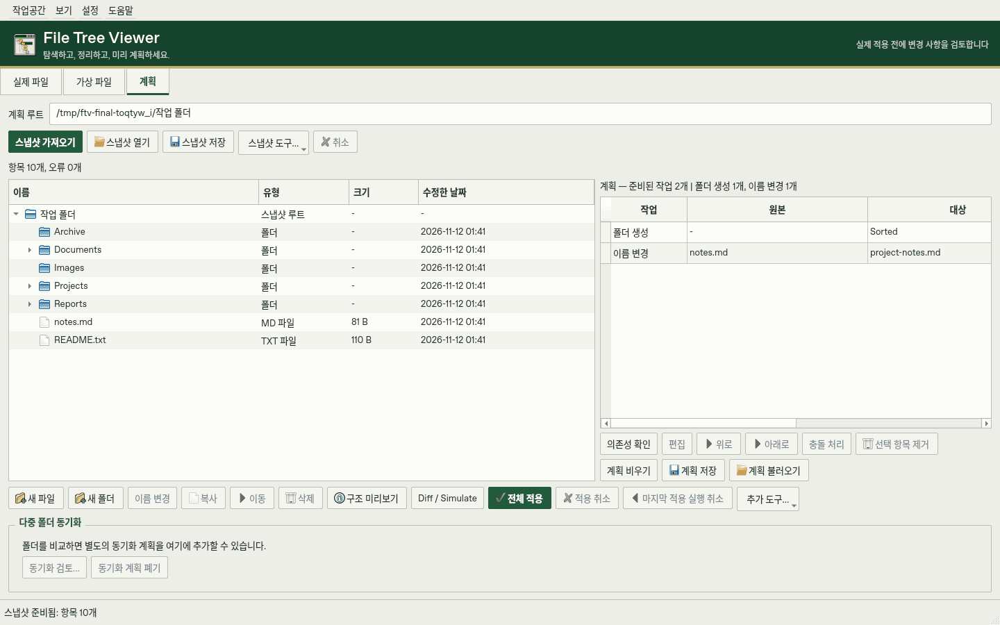

# File Tree Viewer

[한국어 설명](README.md)

A local Python / PySide6 desktop application for browsing real files, editing a virtual file tree, reviewing changes against a Snapshot, and applying recoverable file plans.

## Download and portable use

**Version 1.0.0 is being prepared; no official release has been published.** Sign in to GitHub and download **FileTreeViewer-windows-x64** from a successful [Build Windows run](https://github.com/Koreapanda4444/File-tree-viewer/actions/workflows/build-windows.yml). Extract the artifact, then extract the entire program ZIP inside it. Run `FileTreeViewer/FileTreeViewer.exe`; keep `_internal/` beside it. No Python installation is required.

Settings are stored in `data/settings/preferences.ini`, and history in `data/history/operation-history.sqlite3`, relative to the executable. Close the application before copying or updating it; preserve the existing `data/` folder. Snapshots, virtual trees and plans remain wherever you saved them. Transaction journals and backups remain under each target root's `.file-tree-viewer`, not in application data.

Legacy settings and history can be copied through **Settings → Import Previous Data**. Original data and existing portable values are preserved; an existing portable history DB is not merged or overwritten. Use a writable program folder. [Bilingual portable guide](docs/PORTABLE.md) · [Build and verification](docs/DEVELOPMENT.md)

## Screenshots

Actual application with a disposable sample folder:





## Run

Python 3.12 or later is required. Windows CI uses Python 3.12.

```powershell
python -m pip install -r requirements.txt
python main.py
```

## Workspaces

| Workspace | Features |
| --- | --- |
| Real File System | Editable address bar, background path completion, breadcrumbs, history, favorites, quick access, folder tabs, file operations, text editing, previews and comparison |
| Virtual File System | In-memory tree editing and Undo, JSON save/load, export to a real folder, staging into Plan |
| Plan | Saved Snapshots, structural comparison, diagnostics, duplicate review, staged changes, Diff simulation, transaction Apply, Rollback, recovery and Undo |

Use **Ctrl+1 / Ctrl+2 / Ctrl+3** to switch workspaces. **Workspace** connects Real, Virtual, Plan, folder comparison, disk analysis and history. Importing or staging a plan does not apply it.

## Browse and manage files

Use **Alt+D / Ctrl+L** to edit the address; **Alt+Left / Alt+Right / Alt+Up** navigate history or the parent folder. Folder completion runs in the background, with a maximum of 128 suggestions and 50,000 inspected entries. The current-folder name field locates files as well as folders.

Folder tabs preserve individual navigation history and view mode. Details, List and Large Icons share selection. Directories are fully sorted in the background before rows are paged into view. Watched folders refresh after external changes, with selection and expansion restored where possible. File lists support **Ctrl+C/X/V**, **Ctrl+A**, **F2**, **Delete**, **Ctrl+F**, **F5**, context menus and drag-and-drop. Text editors keep their own clipboard shortcuts.

Copy and move conflicts can be renamed, skipped or stopped. **Last Operation** shows per-item outcomes. Copy cancellation is checked during content transfer and between descendants; an active filesystem call may still need to finish. Real deletions use the recycle bin; they are not restored by Real Undo. Session-based Undo for other Real operations checks for external changes.

## Search and comparison

Live search waits 350 ms, cancels previous requests and ignores stale results. Filters combine extension/type, size, available creation time, modification time and scope. Name matching supports plain text, wildcard and bounded regular expressions.

Content search streams supported text encodings including UTF-8, BOM-detected UTF-16/32 and explicitly selected UTF-16, CP949 or CP1252. It shows matching lines and positions. Limits are 64 MiB per file, 128 KiB per line and 20 matching lines per file. Binary, unreadable or unsupported files are skipped. Search history, presets and JSON/CSV result export are available under **Search Tools**.

Text comparison reads up to 2 MiB and 10,000 lines per file. Saved Snapshot comparison uses metadata; it does not back up or prove equality of file contents. Image and binary previews are bounded. Metadata inspection reports the attributes supplied by the platform and does not evaluate the full ACL.

## Tree export

Use **Workspace → Export Folder Tree** for Real folders, Virtual trees or the original Plan Snapshot. Preview and copy the hierarchy or save TXT, Markdown or JSON. Choose depth, entry limit, hidden files, sizes and excluded folders/extensions. Existing files are not overwritten. Use **Preview Structure** separately for a Plan’s proposed result.

## Plans and synchronization

Real selections, Real-to-Plan drag-and-drop and Virtual export can prepare changes in Plan. COPY and staged UTF-8 contents preserve compatibility with the existing Plan JSON format. Staged text is limited to 1 MiB per file and 64 MiB total.

Review **Diff / Simulate**, dependencies, conflicts and the before/after structure before **Apply All**. Execution validates paths and live state, records a Journal and checksummed Mutation log, and retains backups. Failure or cancellation triggers Rollback. Undo and recovery preserve files when external changes make restoration ambiguous. The single-root Plan does not move files across filesystems.

**Workspace → Compare Folders** compares separate roots, optionally using SHA-256. One-way synchronization can preserve destination-only items or explicitly plan their backed-up deletion. Bidirectional synchronization uses the last successful baseline. Without one, it does not guess whether a missing item was created or deleted; additive initialization must be chosen explicitly. Conflicts require a selected policy or manual resolution.

Synchronization is a separate multi-root coordinator with per-root transactions. A staged synchronization remains in **Plan → Multi-root Synchronization** during the app session. Review creates, overwrites, deletions and **Preview Both Folder Trees** before applying. Both roots are revalidated before changes. Cancel, Undo and interrupted recovery coordinate all participants; every drive must remain available. Recovery data is never automatically deleted. Keep independent backups for important files.

Links/reparse points, overlapping roots, ambiguous names, type conflicts, unreadable scans and conflicting recovery records block synchronization. Cross-drive transfer copies into the destination root before applying local mutations.

## Disk usage and cleanup

**Workspace → Analyze Disk Usage** scans the current Real root without modifying source files. It provides hierarchical totals, a Treemap, folder drilling, parent/path navigation, paged children, file details and **Largest 100 Files**. The table pages through 400 children at a time; the Treemap renders at most 400 large children plus a remainder tile. Empty entries remain available in the table.

Logical size counts every file path. Unique bytes count each identified hard-linked file once, assigned to the first encountered path. Allocated size uses filesystem blocks when available and otherwise estimates from logical size. Compression, deduplication and remote storage can make actual usage differ. Links, reparse points, special files and inaccessible entries are reported and skipped. `.file-tree-viewer` recovery storage is excluded. A scan is not an atomic view of concurrent filesystem changes.

**Show Selected in Real** reveals an item. **Add Selected to Plan** stages copy, move, rename or deletion after validating the Snapshot and selected paths. Choosing deletion in this dialog does not immediately delete files.

## Operation history, reports and recovery history

**Workspace → Operation History** records application-issued Real operations and text saves, Plan Apply/Undo/recovery, and synchronization outcomes. It does not reconstruct old Real operations or monitor changes made by other applications. Filter by UTC date, type, status, path or action; browse 250 events per page, inspect details and reveal locations.

The audit index is `data/history/operation-history.sqlite3` beside the program executable. Logging errors are reported to the application log without reversing completed file operations. The index is separate from the original per-root recovery Journals and backups.

**Export Filtered Report** streams all matching events into a new JSON, CSV or HTML file, including transaction summaries, source/target mutations and Journal references. Existing output, the audit DB and recovery storage are protected. CSV formula prefixes and HTML special characters are escaped. Cancellation discards partial output.

**Workspace → Recovery History** reads existing Journals under a selected root and displays up to 1,000 transactions and recorded failures. Check the selected transaction's Undo safety before requesting restoration. Synchronization checks all participant roots. Execution validates again. Interrupted transactions route to the existing Plan recovery flow. Existing staged Plan changes require review before replacement. Backup deletion is not offered here. Full content validation can take time, and closing waits for safe completion.

## Appearance and shortcuts

**Settings → Preferences** selects English or Korean (restart required), Light, Dark or System theme, preview settings and the default policy for newly staged operations. System follows the color-scheme information supplied by Qt. Comparison colors adapt to the palette. Qt icons and scaling support high DPI.

**View** controls Real, Virtual and Plan panes. Splitter sizes and visibility persist. The last pane in a split group cannot be hidden, and **Restore All Panels** restores the full layout. File-view tools and operation buttons wrap on smaller windows.

**Ctrl+P / Settings → Quick Commands** searches menus and current-workspace commands. Use arrow keys and Enter, save favorites or reuse recent commands. Enter an absolute folder path to navigate or favorite that location. Disabled commands remain unavailable. Dangerous commands require confirmation and retain the original operation checks.

## Windows build and validation

```powershell
build_windows.bat
```

The build produces `release/FileTreeViewer-1.0.0-windows-x64.zip` and `release/SHA256SUMS`. The ZIP includes the executable, `_internal/` runtime and a bilingual guide. The **Build Windows** workflow verifies the executable and extracted ZIP, then retains both files as `FileTreeViewer-windows-x64` for 14 days. It does not publish releases or create tags.

```powershell
python -m pip install ruff==0.16.6
python -m ruff format --check .
python -m ruff check .
python -m compileall -q main.py ui real virtual
python main.py --smoke-test
```

The smoke test uses temporary preferences and checks startup/shutdown of all three workspaces. Reusable checks live in `scripts/verify_core.py`, `scripts/verify_gui.py` and `scripts/verify_portable.py`; fixtures and results are created in disposable temporary folders. `scripts/verify_windows.py` verifies the actual Windows binary and ZIP. Remote filesystems, power-loss behavior and native Windows Explorer drag interactions require environment-specific validation.
